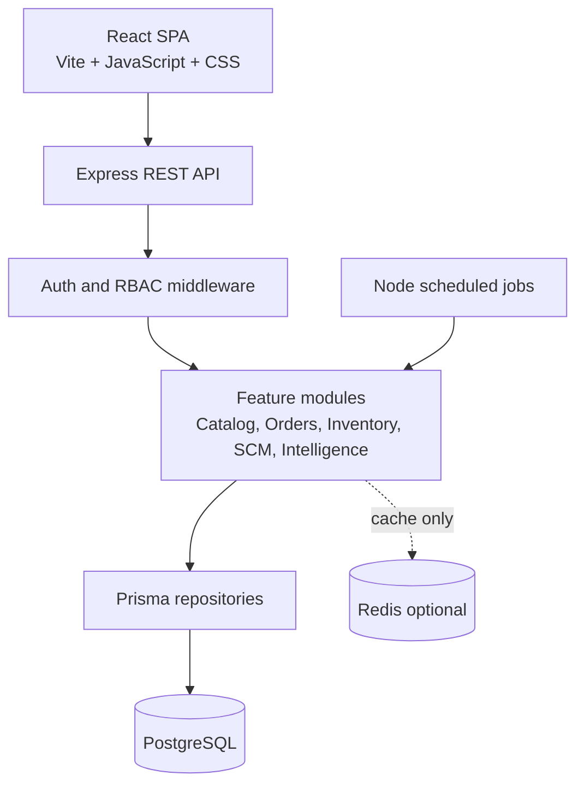
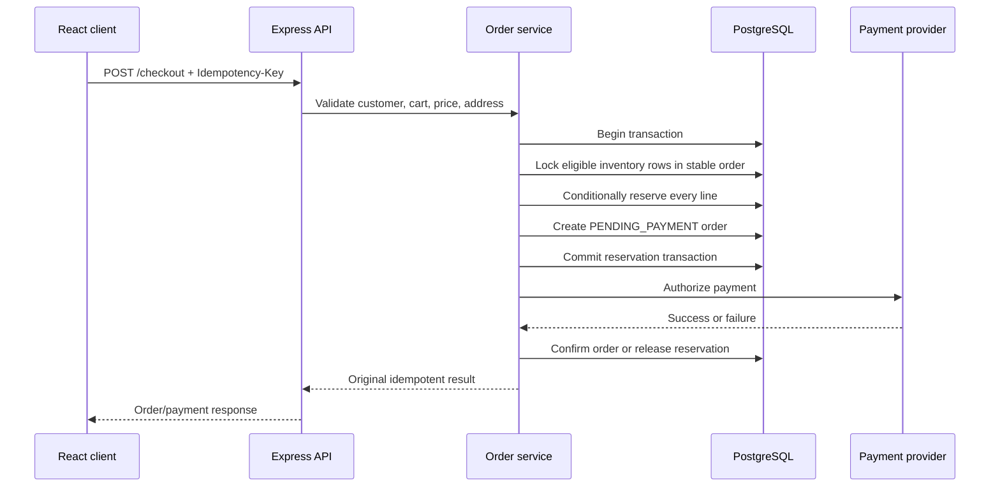

# SupplySense Architecture

## 1. Architecture style

SupplySense uses a React single-page application and a Node.js/Express feature-based modular monolith. PostgreSQL is the source of truth for transactional state. The deterministic intelligence engine runs inside the backend and can later be replaced behind the same interface by an ML service.

## 2. Component view



## 3. Backend module boundaries

| Module | Owns |
|---|---|
| auth | Registration, login, refresh, logout, password policy |
| users | Profiles, roles, warehouse assignments |
| products | Categories, products, variants, product images, prices |
| warehouses | Warehouse master data and manager assignments |
| inventory | Inventory rows, movements, adjustments, transfers, receipts |
| reservations | Stock holds, expiry, release, confirmation |
| cart | Customer cart and cart items |
| wishlist | Customer wishlist |
| orders | Order lifecycle and order history |
| payments | Payment-provider abstraction, idempotency, payment state |
| suppliers | Supplier master data and supplier products |
| purchaseOrders | Purchase orders, shipments, goods receipts |
| tracking | QR/barcode lookup and traceability |
| intelligence | Sales aggregation, forecast, anomaly, recommendation formula |
| audit | Append-only audit events and audit queries |

Routes translate HTTP. Controllers translate HTTP data into service calls. Services enforce business rules. Repositories perform Prisma access. No route should contain inventory or authorization business logic.

## 4. Request flow

```text
Client request
→ request ID and logging middleware
→ Helmet/CORS/rate-limit middleware
→ JWT authentication
→ role and resource-scope authorization
→ request validation
→ controller
→ domain service
→ Prisma repository
→ PostgreSQL transaction when required
→ audit event for critical actions
→ response envelope
```

## 5. Checkout transaction



If payment and database confirmation are separated, a recovery path must reconcile them using the payment reference and idempotency key.

## 6. Data ownership and consistency

- PostgreSQL owns users, catalog, inventory, reservations, orders, payments, suppliers, purchase orders, sales history, recommendations, and audit data.
- Redis, if added, owns only disposable cache entries, counters, and short-lived coordination data.
- React owns presentation state and temporary form state; it does not own authoritative price or stock.
- The formula engine reads PostgreSQL data and writes forecasts/anomalies/recommendations. It never directly changes inventory.

## 7. Authentication architecture

- Access JWT: short lifetime, sent through the approved API client mechanism.
- Refresh JWT: HTTP-only, secure, same-site cookie; rotate on refresh and revoke on logout.
- Password: bcrypt or Argon2 hash with a cost suitable for the deployment environment.
- JWT payload: user ID, role identifiers, token ID, issued time, and expiry; do not put sensitive profile data in the token.
- Every protected query still checks current database permissions and scope.

The frontend keeps the short-lived access token in memory and sends it as `Authorization: Bearer <token>`. It does not persist access or refresh tokens in `localStorage`.

## 8. Formula engine interface

The initial implementation should expose a backend interface similar to:

```text
DemandEstimator.forecast(variantId, warehouseId, horizonDays)
AnomalyDetector.detect(variantId, warehouseId, dateRange)
ReorderEngine.recommend(variantId, warehouseId, inputs)
```

The implementation is mathematical now. A future ML implementation can satisfy the same interface without changing the React screens or public API.

## 9. Architecture decisions

| Decision | Rationale |
|---|---|
| Modular monolith first | Keeps transactions and deployment understandable while preserving feature boundaries |
| PostgreSQL source of truth | Required for relational integrity and safe concurrent inventory updates |
| Prisma repository layer | Centralizes schema access and migrations |
| Formula intelligence in Node | Removes ML infrastructure while preserving the operational workflow |
| Redis optional | Avoids introducing a second state system before it is needed |
| Mock payment first | Allows checkout and idempotency testing without payment credentials |
| REST API versioned as `/api/v1` | Keeps frontend/backend contracts explicit and future-compatible |
