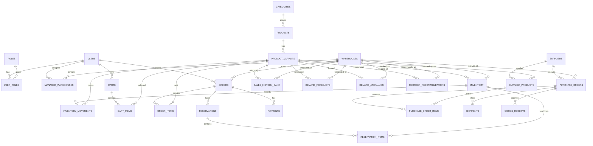

# PostgreSQL Database Design

## 1. Conventions

- Use UUID primary keys.
- Store timestamps as timezone-aware timestamps in UTC.
- Use `numeric(12,2)` or integer minor units for money; never use floating point for monetary values.
- Use non-negative integer quantities for units.
- Use database foreign keys for relationships.
- Add `created_at` and `updated_at` to mutable business tables.
- Use status columns with service validation and database checks where practical.
- Prefer deactivation/soft deletion for products, SKUs, warehouses, and suppliers referenced by history.

## 2. Entity relationship diagram



## 3. Core tables

### Identity

- `users`: email, password hash, name, active status.
- `roles`: stable role code and display name.
- `user_roles`: user-role join table.
- `refresh_tokens`: hashed token identifier, user, expiry, revocation timestamp.
- `manager_warehouses`: manager-to-warehouse scope.

### Catalog

- `categories`: name, slug, active status.
- `products`: category, name, description, active status.
- `product_variants`: product, SKU, attributes JSON, price, active status, barcode.
- `product_images`: variant/product image URL and display order.

### Inventory

- `warehouses`: name, code, address, active status.
- `inventory`: warehouse, variant, on-hand quantity, reserved quantity, reorder settings.
- `inventory_movements`: movement type, quantity, before/after values, actor, reference type, reference ID.
- `inventory_batches`: inventory, batch code, expiry date, quantity.

### Commerce

- `carts`, `cart_items`, `wishlists`, `wishlist_items`.
- `addresses`.
- `orders`, `order_items`, `order_status_history`.
- `reservations`, `reservation_items`.
- `payments`.
- `idempotency_keys`.

### Supply chain

- `suppliers`: supplier identity and active status.
- `supplier_products`: supplier, variant, supplier SKU, cost, lead time, MOQ, pack size.
- `purchase_orders`, `purchase_order_items`.
- `shipments`.
- `goods_receipts` and `goods_receipt_items`.

### Formula intelligence and audit

- `sales_history_daily`: variant, warehouse, business date, units sold, revenue, stockout flag.
- `demand_forecasts`: horizon, predicted daily demand, predicted total, formula version, inputs.
- `demand_anomalies`: observed value, expected value, standard deviation, z-score, direction.
- `reorder_recommendations`: inputs, quantity, priority, explanation, status, decision actor.
- `audit_logs`: actor, action, resource, resource ID, outcome, correlation ID, safe metadata.

## 4. Required constraints

```text
users.email UNIQUE
categories.slug UNIQUE
product_variants.sku UNIQUE
warehouses.code UNIQUE
inventory (warehouse_id, variant_id) UNIQUE
sales_history_daily (variant_id, warehouse_id, business_date) UNIQUE
idempotency_keys (user_id, key, operation) UNIQUE
```

Recommended checks:

```text
on_hand_quantity >= 0
reserved_quantity >= 0
reserved_quantity <= on_hand_quantity
quantity > 0 for movement/order/reservation lines
pack_size > 0
lead_time_days >= 0
```

## 5. Important indexes

- `product_variants(sku)`
- `products(category_id, active)`
- `inventory(warehouse_id, variant_id)`
- `inventory_movements(warehouse_id, variant_id, created_at)`
- `orders(customer_id, created_at)`
- `orders(warehouse_id, status, created_at)`
- `reservations(status, expires_at)`
- `purchase_orders(supplier_id, status, created_at)`
- `sales_history_daily(variant_id, warehouse_id, business_date)`
- `reorder_recommendations(warehouse_id, status, priority, created_at)`
- `audit_logs(resource_type, resource_id, created_at)`

## 6. Transaction boundaries

Use a single PostgreSQL transaction for:

- Multi-line stock reservation
- Reservation release/expiry
- Order cancellation with stock release
- Inventory transfer
- Goods receipt and stock increase
- Payment-confirmation state update when paired with order confirmation
- Recommendation approval and purchase-order creation

## 7. Data retention

- Keep orders, payments, inventory movements, goods receipts, and audit logs for the configured business retention period.
- Do not hard-delete records referenced by financial or inventory history.
- Refresh-token records may be deleted after expiry and configured retention.
- Aggregated sales history may be retained after source order cleanup only if its lineage policy is documented.
